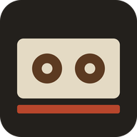
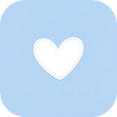

  
    
  

### ▸ ABOUT ME

I'm a creative person and I enjoy turning ideas into real projects, from a first sketch to something people actually use.

Digital sovereignty matters to me: I want to know where my data lives and who controls it. So I host things myself. A local AI server with 24 GB of VRAM handles the AI, and a Raspberry Pi 5 runs my apps.

### ▸ OPEN SOURCE

####  [Lern-PWA](https://github.com/Guppy997/lern-pwa)

A study tracker for focused learning. Plan your day per project, learn in focus sessions (25/5, 52/17 or your own length) and write down what stuck right after each one. A learning calendar and weekly stats show when, how long and how well you studied.

React · Express · SQLite · Docker · installable PWA · 16 API tests with CI · MIT 
**[Repository →](https://github.com/Guppy997/lern-pwa)** · [Features](https://github.com/Guppy997/lern-pwa#funktionen) · [Self-hosting](https://github.com/Guppy997/lern-pwa#selbst-hosten)

####  [Fitness-PWA](https://github.com/Guppy997/fitness-pwa)

A workout tracker for home and gym. A short daily routine to tick off, plus gym workouts in rotation with set tracking, remembered weights and an automatic rest timer. Heatmap, weekly goal, streak and personal records show the progress.

React · Express · SQLite · Docker · installable PWA · 18 API tests with CI · MIT 
**[Repository →](https://github.com/Guppy997/fitness-pwa)** · [Features](https://github.com/Guppy997/fitness-pwa#funktionen) · [Self-hosting](https://github.com/Guppy997/fitness-pwa#selbst-hosten)

Both are self-hosted on my Raspberry Pi 5: no account, no tracking. The interface and READMEs are in German, each README starts with a short English summary.

### ▸ PROJECTS

####  [Kliqtape](https://kliqtape.de)

A social app for small, fixed groups of friends, without ads, algorithm or likes. Every group is a cassette: side A is the group's lasting archive, side B its ongoing group chat. Instead of likes you react with a few seconds of voice, and instead of an endless feed the tape simply ends. At its heart is the mixtape: a playlist you put together for exactly one person, with a cover and a handwritten dedication.

React 19 · TypeScript · Express · SQLite · installable PWA prototype, native app planned · 146 API tests with CI · AGPL-3.0 
**[kliqtape.de →](https://kliqtape.de)**

Open source under AGPL-3.0. The repository goes public soon.

####  [WeddingKids](https://github.com/Guppy997/weddingkids-showcase)

Planning app for a small company that looks after children at weddings, in production since May 2026. Requests come in, the team answers yes, no or maybe, the owners assign staff, and everyone sees their own shifts in a calendar. Live updates and push notifications keep everyone in sync.

React 19 · TypeScript · Express · SQLite · roles checked on the server · 121 tests with CI · Apache-2.0 
**[Repository →](https://github.com/Guppy997/weddingkids-showcase)** · [Security](https://github.com/Guppy997/weddingkids-showcase#sicherheit-und-datenschutz) · [Architecture](https://github.com/Guppy997/weddingkids-showcase#architektur)

The repository is a showcase with demo data, the production code stays private.

### ▸ TOOLKIT

  
  
  
  
  

  
  
  
  

  
  
  
  
  
  

  
  
  
  

  MADE IN COLOGNE · 50°56′29″N 6°57′30″E

